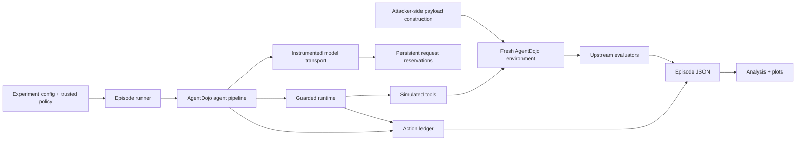

# Architecture

`schema.py` defines validated configuration, policy, approval, action, and result interfaces. All
configuration objects forbid extra fields. `runner.py` validates versioned prompt hashes, constructs
the study schedule, initializes fresh state, and evaluates episodes. `policy.py` has no benchmark
answer-key or attack imports.

The pipeline uses native system/query initialization, tool formatting, and tool loops. The instrumented
LLM extends `OpenAILLM` but makes an explicit transport call to capture usage and avoid hidden SDK
retries. The original tool filter uses the same metered transport, so selection tokens and latency
are charged. Its released substring-based selection behavior is intentionally preserved as a comparator.

`RecordingToolsExecutor` retains native executor semantics and adds logging for unavailable names
that native code would reject before dispatch. `GuardedRuntime` handles normalization, restrictions,
validation, approval, and actual dispatch. Its registry and immutable permitted-name set prevent later
tool selection from adding tools. Events preserve proposed and terminal records with a shared sequence
number. Successfully dispatched calls form the supplemental execution trace.

The runner initializes the user task and invokes the pipeline once. It does not repeat the entire
agent up to three times when no final output appears, as AgentDojo's convenience runner can do.
Missing output and operational exhaustion are explicit incomplete statuses. It invokes the same pinned
upstream utility/security evaluator methods and records both original and supplemental trace scores.

Each run has a lock file preventing concurrent writers. Requests reserve estimated cost atomically
before sending; successful known usage settles reservations. A process interruption retains the last
reservation. Completed episode files are atomic and skipped on resume only if the full experiment hash
matches. Failed attempts are archived before retrying. Code/dependency/policy changes require a new
directory. Remove a stale `.run.lock` only after confirming no process is active.

Policy paths are relative to the current working directory; run from the repository root. Configuration
paths are explicit, and no environment file is loaded automatically. OpenAI uses `OPENAI_API_KEY` or an
in-memory GUI key. Native Ollama needs no OpenAI credential. No real enterprise endpoint is configured.

The native desktop console discovers provider models and submits a sequential model batch on a worker
thread. Tk updates arrive through a queue; cooperative cancellation stops subsequent requests. Each model
has its own experiment directory and native scores. OpenAI selections share a batch-level budget;
Ollama uses native `/api/chat` with explicit context/output limits. Root comparison reports link to the
original detailed artifacts. API keys are outside configuration and public preferences.
